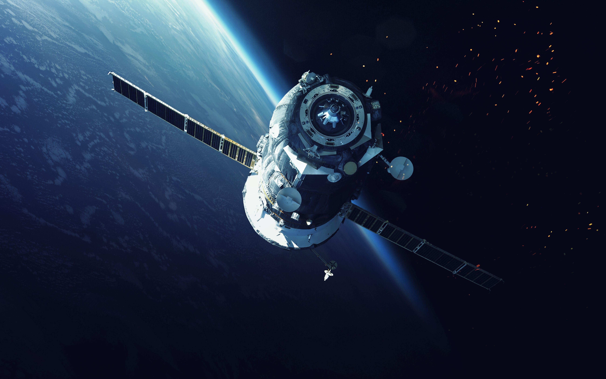

# SatSim

**Six-Degree-of-Freedom Spacecraft Simulator**

Explore spacecraft translation, attitude control, and docking in an interactive browser environment.

[**Launch Simulator**](https://sm-nasim.github.io/satsim/) · [**Open Spacecraft Editor**](https://sm-nasim.github.io/satsim/editor/) · [**Report an Issue**](https://github.com/sm-nasim/satsim/issues)

## Overview

SatSim provides a 3D environment for practicing spacecraft maneuvers and exploring custom spacecraft configurations. Use the included scenario to get started, or import your own spacecraft geometry, propulsion layout, and docking setup.

- **6DOF motion:** control translation along three axes and rotation in roll, pitch, and yaw.
- **Attitude control:** switch between thrusters, reaction wheels, and control moment gyroscopes (CMGs).
- **Custom spacecraft:** configure models, mass properties, thrusters, cameras, and lights in the editor.
- **Docking practice:** maneuver toward a docking structure or a configured static target spacecraft.
- **Flight feedback:** monitor position, velocity, attitude, fuel, and docking status.
- **Collision visualization:** compare the visual collision bounds with the actual physics box.
- **Custom keyboard controls:** remap movement keys and import or export your bindings.

## Quick Start

1. Open the [simulator](https://sm-nasim.github.io/satsim/).
2. Choose the option to start with the default model and configuration.
3. The simulation begins paused. Hold **Backtick** and press **P** to resume or undock.
4. Use **W / S / A / D / Q / E** to translate and **I / K / J / L / U / O** to rotate.
5. Press **C** to change camera mode. In orbit and selfie-stick views, drag with the left mouse button to move the camera and scroll to zoom.

> **Backtick** is the ` key, usually located to the left of **1** and shared with **~**. Hold it while pressing a shortcut key.

## Flight Controls

### Movement

These are the default bindings. Axis labels follow the simulator's coordinate conventions.

| Action | Positive direction | Negative direction |
| --- | --- | --- |
| Translate X | A | D |
| Translate Y | E | Q |
| Translate Z | W | S |
| Pitch | K | I |
| Yaw | J | L |
| Roll | O | U |

Select **Customize Controls** in the simulator to change or reset movement bindings. Your preferences are saved in the current browser; export them to transfer a layout to another browser or computer.

### View and Simulation Shortcuts

| Control | Action |
| --- | --- |
| C | Cycle camera modes |
| V | Toggle spacecraft lights |
| T | Cycle attitude-control modes |
| Caps Lock | Toggle fine-control mode |
| Backtick + P | Pause or resume; undock when docked |
| Backtick + F | Alternate pause/resume and undock shortcut |
| Backtick + R | Reset the simulation |
| Backtick + H | Toggle collision and hull visualization |
| Backtick + B | Toggle docking-zone boxes |
| Backtick + X | Toggle distance information |
| Backtick + Z | Cycle the docking zone shown in the HUD |

## Load a Custom Scenario

Use the start-page upload fields to supply your scenario files. The interface supports:

| File | Purpose |
| --- | --- |
| Spacecraft model (`.stl`) | Geometry of the spacecraft you control |
| Docking-port model (`.stl`) | Geometry of the docking structure |
| Complete configuration (`.json`) | Spacecraft properties and component configuration |
| Initial position and orientation (`.json`) | Starting spacecraft pose and supported docking parameters |
| Second spacecraft model (`.stl`) | Optional static target geometry |
| Second spacecraft position (`.json`) | Placement of the static target |
| Second spacecraft docking location (`.json`) | Docking reference for the static target |

The repository includes [an example spacecraft configuration](example-spacecraftconfig.json), [a target position file](example-secondspacecraftposition.json), and [a target docking-location file](example-secondspacecraft_dockingport.json) for reference.

### Docking

Use the docking information in the HUD to monitor your approach. After undocking, leave the docking area before attempting to dock again. A successful docking pauses the simulation; use **Backtick + P** or **Backtick + F** to undock.

### Inspect Collision Bounds

Press **Backtick + H** to display both spacecraft collision representations:

- **Green wireframe:** the visual collision bounding box.
- **Magenta edges:** the actual Cannon physics collision box.

These boxes should overlap as the spacecraft translates and rotates. The browser console also reports the model transforms, bounding-box measurements, body pose, shape offset, and center-of-mass metadata to help diagnose alignment issues.

## Spacecraft Editor

Open the [editor](https://sm-nasim.github.io/satsim/editor/) to build or revise a spacecraft configuration.

1. **Import the model.** Load your spacecraft STL and check its dimensions and orientation.
2. **Set the units.** Use metric units throughout. Convert millimeter-based CAD exports to meters with a scale factor of `0.001`; inch-based exports require `0.0254`.
3. **Configure mass properties.** Enter the spacecraft mass, fuel, inertia, and center-of-mass information.
4. **Add components.** Configure thrusters, cameras, lights, reaction wheels, and CMGs as needed.
5. **Export the configuration and model.** Load the exported files together in the simulator.

Import a saved configuration to continue editing later. In the editor, left-drag to orbit the camera and scroll to zoom.

### Scale and Coordinate Consistency

The editor's STL export includes the model's applied scale and CG translation. Keep the exported model and its matching configuration together, and avoid applying the same unit conversion again after export.

Thruster key assignments in the editor refer to internal control commands. Physical keyboard remapping is managed separately through **Customize Controls** in the simulator.

### Current Limitations

- Some editor visualizations may require toggling their visibility off and on after a change.
- Reaction-wheel positions currently do not affect the simulation.
- Nonorthogonal reaction-wheel layouts, configurations with more than three wheels, and multiple-CMG configurations require further validation.

## Troubleshooting

| Issue | Suggested action |
| --- | --- |
| Spacecraft does not move | Resume the simulation and check the active control bindings and available fuel. |
| Model appears too large or too small | Check the CAD export units and the scale applied in the editor. |
| Editor visualization appears stale | Toggle the affected visualization off and on. |
| Collision appears displaced | Enable collision visualization and compare the green and magenta boxes; inspect the console transforms. |
| Published site shows an older version | Wait for the [Pages deployment](https://github.com/sm-nasim/satsim/actions) to finish, then hard refresh with **Cmd + Shift + R** on macOS or **Ctrl + Shift + R** on Windows/Linux. |

## Feedback and Issue Reports

Submit bugs and suggestions through [GitHub Issues](https://github.com/sm-nasim/satsim/issues). For reproducible reports, include your browser and operating system, the steps to reproduce the issue, relevant model and configuration files, and any console errors or screenshots.
